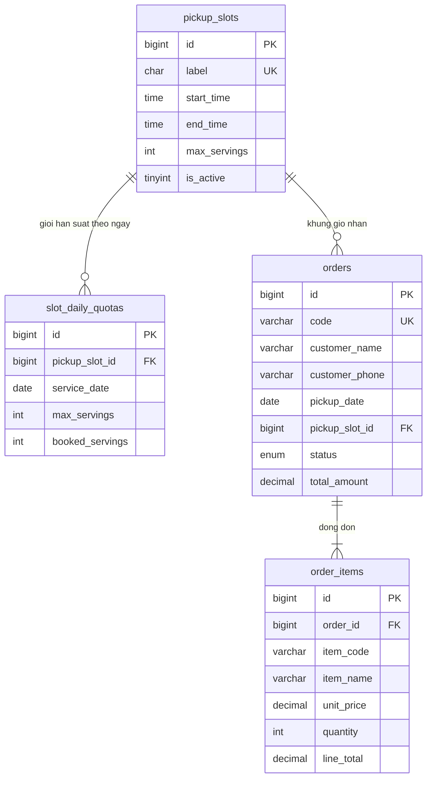

# TF1ABCE — Bảng đơn hàng, dòng đơn và khung giờ nhận

Script tạo bảng: `sql/tf1abce_orders.sql`  
Bộ test: `sql/tests/tf1abce_test_cases.sql`  
Đã chạy trên MySQL `quickbite`. 9/9 test PASS. Bảng `tf1abce_test_results` giữ kết quả để chụp màn hình.

## Sơ đồ

`pickup_slots.max_servings` là giới hạn suất của khung giờ, áp dụng cho mỗi ngày. `slot_daily_quotas` đếm số đơn còn hiệu lực. Trigger chỉ cộng suất khi `booked_servings < max_servings`. Hủy hoặc xóa đơn thì trả suất. `order_items.line_total` phải bằng `unit_price * quantity` (số lượng 1–10). `orders.total_amount` được cộng từ từng dòng.

18 khung giờ, cách nhau 30 phút, từ 10:30 đến 19:00 (khớp trang đặt món). Giờ trưa 30 suất, giờ chiều 25 suất, các khung còn lại 15–20 suất.

## Test case

| Mã | Việc kiểm tra | Kỳ vọng | Kết quả thực tế | Kết quả |
|---|---|---|---|---|
| TC01 | Đặt đơn 2 món (cơm gà 45.000 × 1, trà đá 5.000 × 2) | Tổng 55000, booked = 1 | Tong 55000, booked = 1 | PASS |
| TC02 | Dòng đơn có thành tiền sai | Vi phạm `chk_order_items_line_total` | Check constraint `chk_order_items_line_total` is violated | PASS |
| TC03 | Số lượng 11 | Vi phạm `chk_order_items_qty` | Check constraint `chk_order_items_qty` is violated | PASS |
| TC04 | Khung giờ chỉ 1 suất, đặt đơn thứ 2 | `Khung gio da het suat trong ngay` | Đúng thông báo | PASS |
| TC05 | Hủy đơn rồi đặt lại trên khung 1 suất | Sau hủy booked = 0, đặt lại booked = 1 | Sau huy 0, dat lai 1 | PASS |
| TC06 | Khung giờ `is_active = 0` | `Khung gio nhan dang tat` | Đúng thông báo | PASS |
| TC07 | Xóa đơn đang hiệu lực | Trước xóa 1, sau xóa 0 | Truoc xoa 1, sau xoa 0 | PASS |
| TC08 | Xóa khung giờ còn đơn | Khóa ngoại `fk_orders_pickup_slot` | Cannot delete or update a parent row | PASS |
| TC09 | Hai đơn cùng mã | Trùng `uq_orders_code` | Duplicate entry `TF1ABCE-TC09` | PASS |

Dữ liệu test dùng ngày `2099-11-13` và được xóa cuối script. 18 khung giờ thật vẫn còn.
